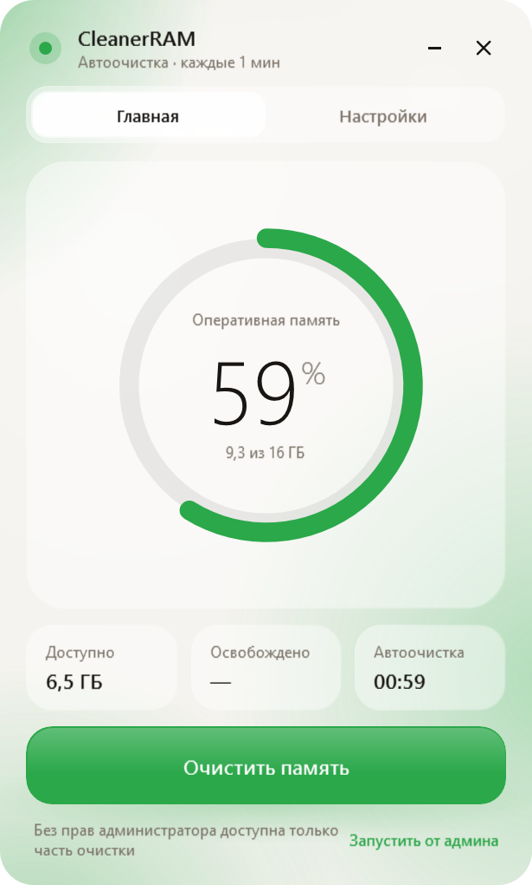
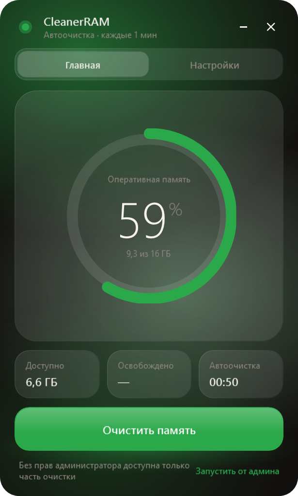

# CleanerRAM

<div align="center">

-0078D4?style=flat-square&logo=windows)


**Низкоуровневая легковесная утилита оптимизации оперативной памяти для Windows.**  
*Прямой доступ к подсистеме управления памятью NT через нативные Win32/NT API без сторонних зависимостей и фонового оверхеда.*

[English Overview](#english-overview) • [Возможности](#возможности) • [Архитектура и NT API](#архитектура-и-nt-api) • [Сборка](#сборка-из-исходников) • [CLI и автозапуск](#параметры-запуска-и-настройки)

</div>

---

<div align="center">
  
  &nbsp;&nbsp;&nbsp;&nbsp;
  
</div>

---

## О проекте

Большинство сторонних оптимизаторов памяти перегружены телеметрией, тяжелыми фреймворками и агрессивными таймерами, вызывающими микрофризы в играх и рабочем софте. 

**CleanerRAM** спроектирован с упором на минимализм, предсказуемость системных вызовов и нулевой фоновый оверхед:
- Исполняемый файл весит всего **~92 КБ** и не требует установки.
- Работает напрямую с ядром Windows (`ntdll.dll`, `kernel32.dll`, `psapi.dll`, `advapi32.dll`).
- Интерфейс реализован на аппаратном WPF без раздутых UI-библиотек (динамическая загрузка XAML через `XamlReader`).
- Поддерживает безопасный фоновый режим «Gentle Clean», исключающий просадки FPS и лаги интерфейса.

---

## Возможности

- **Очистка рабочих наборов (Working Sets)**: безопасный сброс страниц неактивных фоновых процессов (`EmptyWorkingSet`). Процессы оболочки (`dwm`, `explorer`, `ctfmon`) и активное окно переднего плана автоматически исключаются.
- **Очистка Standby List (Кэш ожидания)**: принудительный сброс закэшированных страниц памяти ядра через закрытый системный вызов `NtSetSystemInformation` (`SystemMemoryListInformation = 80`).
- **Сброс Modified Page List**: запись изменённых страниц памяти на диск для высвобождения физических страниц под активные задачи.
- **Очистка системного файлового кэша**: вызов `SetSystemFileCacheSize` для регулирования размера кэша файловой системы.
- **Щадящая фоновая автоочистка (Gentle Mode)**:
  - Фоновый поток работает с пониженным приоритетом (`ThreadPriority.BelowNormal`).
  - Фильтрует фоновые приложения: очищаются только процессы с рабочим набором выше установленного порога (150 МБ в авторежиме).
  - Сброс Standby-кэша триггерится только при реальной нехватке физической памяти (< 12% свободно).
- **Динамический системный трей**: иконка в трее рисует текущий процент загрузки RAM в реальном времени с поддержкой быстрого контекстного меню.
- **Современный Glassmorphism UI**: плавная анимация на сплайнах Безье, поддержка светлой и тёмной темы, выбор акцентного цвета, локализация (RU / EN).
- **Автозапуск Windows**: интеграция через Windows Task Scheduler (с наивысшими правами `RunLevel Highest`, без раздражающих окон UAC при входе в систему) либо через ветку реестра `HKCU\Software\Microsoft\Windows\CurrentVersion\Run`.

---

## Архитектура и NT API

Утилита обращается к следующим системным вызовам и привилегиям Windows:

| API / Привилегия | Библиотека | Назначение |
| :--- | :--- | :--- |
| `GlobalMemoryStatusEx` | `kernel32.dll` | Снятие моментального снимка состояния физической и виртуальной памяти. |
| `EmptyWorkingSet` | `psapi.dll` | Выгрузка неиспользуемых страниц рабочего набора выбранного процесса в файл подкачки. |
| `NtSetSystemInformation` | `ntdll.dll` | Информационный класс 80 (`SystemMemoryListInformation`): команда `3` (Flush modified list), команда `4` (Purge standby list). |
| `SetSystemFileCacheSize` | `kernel32.dll` | Ограничение системного файлового кэша ядра. |
| `AdjustTokenPrivileges` | `advapi32.dll` | Активация привилегий маркера процесса: `SeProfileSingleProcessPrivilege`, `SeIncreaseQuotaPrivilege`, `SeDebugPrivilege`. |
| `GetForegroundWindow` | `user32.dll` | Определение активного процесса пользователя для защиты от выгрузки его памяти. |

### О правах администратора (UAC)

CleanerRAM запускается без обязательного требования прав администратора. В непривилегированном режиме доступна очистка рабочих наборов разрешённых пользовательских процессов. 

Для вызова низкоуровневых команд `NtSetSystemInformation` (очистка Standby и Modified списков) и `SetSystemFileCacheSize` требуются права администратора (`SeProfileSingleProcessPrivilege` и `SeIncreaseQuotaPrivilege`). В интерфейсе предусмотрена кнопка мгновенного перезапуска с повышенными привилегиями.

---

## Структура репозитория

```
ram-cleaner/
├── .github/
│   └── workflows/
│       └── build.yml          # GitHub Actions CI для сборки проекта
├── assets/
│   └── app.ico                # Многослойная векторно-генерированная иконка
├── docs/
│   ├── preview_main.png       # Скриншот: светлая тема
│   ├── preview_dark.png       # Скриншот: тёмная тема
│   ├── preview_settings.png   # Скриншот: основные настройки
│   └── preview_settings2.png  # Скриншот: дополнительные параметры
├── src/
│   ├── App.cs                 # Точка входа, P/Invoke Win32/NT, модуль Cleaner, планировщик
│   ├── UI.cs                  # Логика интерфейса, динамический трей, анимации, локализация
│   ├── ui.xaml                # Разметка XAML (Liquid Glass стили, темы, контролы)
│   ├── app.manifest           # Манифест UAC и Per-Monitor V2 DPI awareness
│   └── app.manifest.xml       # Резервный XML-манифест
├── build.bat                  # Однокликовый батник сборки под Windows
├── build.ps1                  # Автономный PowerShell-скрипт сборки через csc.exe
├── CleanerRAM.csproj          # Проектная модель для .NET SDK / MSBuild / Rider / VS
├── CleanerRAM.sln             # Решение для Visual Studio 2019/2022
├── CleanerRAM.exe             # Готовый скомпилированный бинарник x64 (~92 КБ)
├── LICENSE                    # Лицензия Apache 2.0
└── README.md                  # Документация проекта
```

---

## Сборка из исходников

### Способ 1: Автономный скрипт (без Visual Studio и .NET SDK)

Проект компилируется встроенным компилятором Windows C# (`csc.exe`), присутствующим в любой современной системе с .NET Framework 4.0+.

```powershell
# Запуск через PowerShell:
powershell -ExecutionPolicy Bypass -File .\build.ps1

# Тестовая сборка без запроса UAC:
powershell -ExecutionPolicy Bypass -File .\build.ps1 -Test
```

Или просто запустите `build.bat` двойным кликом.

### Способ 2: Через .NET SDK / Visual Studio

```bash
# Сборка Release x64 через dotnet CLI:
dotnet build CleanerRAM.sln -c Release -p:Platform=x64

# Или открытие решения CleanerRAM.sln в Visual Studio / JetBrains Rider
```

---

## Параметры запуска и настройки

| Аргумент | Описание |
| :--- | :--- |
| `CleanerRAM.exe` | Стандартный запуск с отображением главного окна. |
| `CleanerRAM.exe --tray` | Запуск в фоновом режиме, минимизированном в системный трей. |
| `CleanerRAM.exe --shot <prefix>` | Служебный режим для фонового рендеринга скриншотов интерфейса в PNG. |

Конфигурация утилиты автоматически сохраняется в:
```
%APPDATA%\CleanerRAM\settings.ini
```

---

## English Overview

**CleanerRAM** is a zero-bloat, native Windows RAM optimization utility written in C# and Win32/NT P/Invoke.

### Key Highlights
- **Ultralight Weight**: Standalone ~92 KB x64 portable executable.
- **Kernel-level Precision**: Calls undocumented `NtSetSystemInformation` (`SystemMemoryListInformation = 80`) to flush Modified Page Lists and purge Standby Cache Lists without third-party service overhead.
- **Gentle Auto-Clean**: Automatically detects foreground processes and critical Windows OS components (`dwm`, `explorer`, `ctfmon`, audio subsystem), preventing game stutters and input lag.
- **Hardware-accelerated WPF UI**: Clean glassmorphism aesthetic with Bezier spring animations, light/dark themes, custom accent picker, and bilingual localization (RU/EN).
- **Live Tray Icon**: Draws real-time memory usage percentage directly on the taskbar tray icon.
- **Built-in Autostart**: Native integration with Windows Task Scheduler (`HighestAvailable` execution level) and Windows Run registry key.

---

## Лицензия

Проект распространяется под лицензией [Apache License 2.0](LICENSE).
